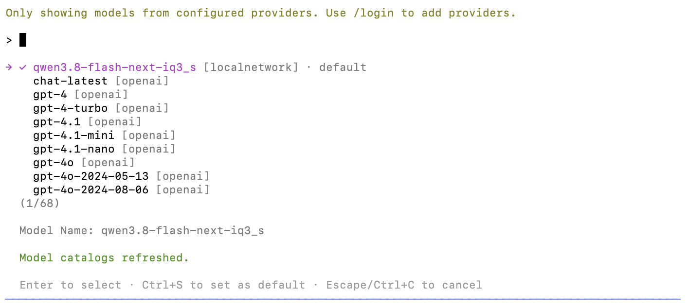
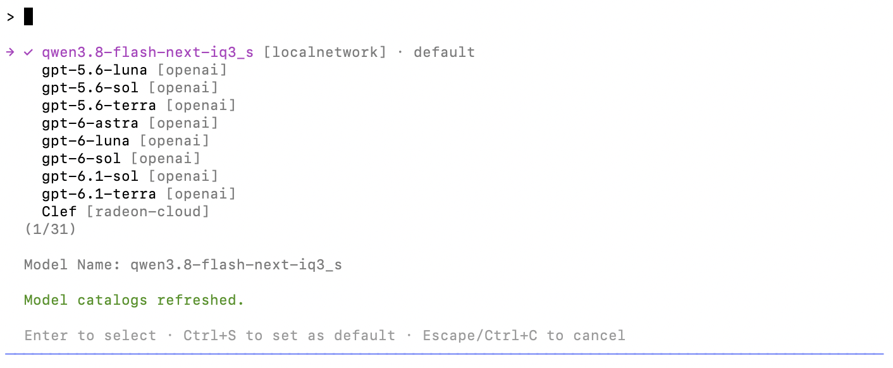

# pi-codex-visibility-filter

| Before | After |
|---|---|
|  |  |
| 68 models, include legacy models | 30+ models filtered |

Filter Pi’s model list using visibility metadata from OpenAI’s model catalog like Codex.
Works with Pi's `openai` ChatGPT login.

## Install

```sh
pi install git:github.com/80ROkWOC4j/pi-codex-visibility-filter
```

Restart Pi. If needed, run `/login openai` and choose **Sign in with ChatGPT**.

## Behavior

- Shows only models marked `visibility: "list"`.
- Hidden models remain usable through CLI `--model`, but not RPC `set_model`.
- Fetch catalog on Pi start. Restart Pi to refresh the catalog.

Run `/codex-visibility` to check status.

## Development

```sh
npm ci --ignore-scripts
npm test
npm run check
npm run test:integration
```
